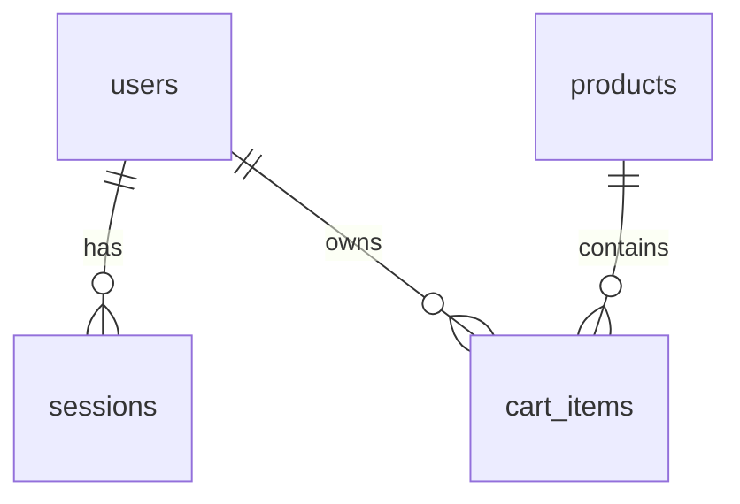

# Строймаркет

Учебный веб-проект по дисциплине «Интернет-технологии». **Вариант №14 — «Магазин стройматериалов»**. Особенность варианта — калькулятор количества материала по площади или объёму.

Репозиторий: https://github.com/rustkoff/stroymarket

## Что реализовано

- **ПР 1:** семь связанных страниц, общий `style.css`, семантическая разметка, Grid/Flexbox, собственные SVG-логотип и иллюстрации, адаптация под 360 px.
- **ПР 2:** фильтрация по названию, категории и цене, сортировка, калькулятор, форма обратной связи; сообщения об ошибках рядом с полями. Курс USD загружается через `fetch` из внешнего API с состояниями загрузки и ошибки.
- **ПР 3:** FastAPI, SQLite, 15 товаров, регистрация, вход, выход, личный профиль и сохраняемая корзина; библиотечный Argon2 для паролей, параметризованный SQL, серверная проверка доступа.
- **ПР 4 — подготовка:** зафиксированные зависимости, Dockerfile, CI со сборкой и проверкой контейнера, инструкция запуска и размещения. Постоянный хостинг и домен **ещё не настроены**, ПР 4 целиком не завершена.

Это учебный магазин: ассортимент, адрес и телефон демонстрационные; настоящих заказов и платежей нет. Итоговый отчёт пока представлен планом, а не готовым документом для сдачи.

## Быстрый запуск

Нужен Python 3.12. Из корня репозитория:

```sh
python3 -m venv .venv
. .venv/bin/activate
python -m pip install -r requirements.lock
python -m uvicorn backend.main:app --host 0.0.0.0 --port 3000
```

Windows PowerShell: вместо активации выше выполните `.venv\Scripts\Activate.ps1`. Для `uvloop` в lock-файле указан платформенный маркер: на Windows он не устанавливается. Эталонное окружение — Linux/Python 3.12 или Docker.

Откройте http://localhost:3000. SQLite создаётся автоматически в `data/store.db`, каталог заполняется при первом запуске. Не открывайте HTML через `file://`: интерфейсу нужен API.

**Проверочная учётная запись:** создайте свою через «Личный кабинет». Готовых паролей и пользовательских баз в репозитории нет. Для демонстрации преподавателю зарегистрируйте отдельный тестовый аккаунт на развёрнутом сайте и передайте его данные лично.

## Страницы

| Адрес | Назначение |
| --- | --- |
| `/` или `/index.html` | Главная, категории, 6 материалов |
| `/catalog.html` | 15 товаров, фильтрация и сортировка |
| `/product.html?id=cement` | Карточка товара, характеристики и цена |
| `/calculator.html` | Расчёт по площади или объёму |
| `/cart.html` | Персональная корзина и внешний курс валют |
| `/contacts.html` | Контакты и обратная связь |
| `/account.html` | Регистрация, вход и профиль |
| `/docs` | Автоматическая документация FastAPI |

## Калькулятор

Площадь `S = длина × ширина`. Объём `V = длина × ширина × толщина` (в метрах). Количество упаковок:

```text
N = ceil(S или V × (1 + запас / 100) / покрытие одной упаковки)
стоимость = N × цена единицы продажи
```

Для площади известное покрытие подставляется из товара. Если его нет или выбран объём, введите покрытие/объём единицы продажи вручную. Расход смесей зависит от толщины слоя и основания: проверяйте упаковку и характеристики товара. Запас от 0 до 50%; количество округляется вверх, в корзину можно добавить до 999 единиц одной позиции. Это ориентировочная смета, не строительная экспертиза.

## Внешний источник

[Курсы валют ЦБ РФ в JSON](https://www.cbr-xml-daily.ru/) — `https://www.cbr-xml-daily.ru/daily_json.js`. На странице корзины нажмите «Загрузить курс ЦБ». Используются `Valute.USD.Value / Nominal` и дата `Date`; корзина справочно пересчитывается в USD, базовые цены остаются в рублях. Ключ не нужен. Сервис обновляет данные по расписанию ЦБ, поэтому дата курса может отличаться от текущей даты. Таймаут 10 секунд; при отказе источника интерфейс и рублёвые цены продолжают работать.

## API

| Метод и путь | Назначение |
| --- | --- |
| `GET /api/products` | Все товары из SQLite |
| `GET /api/products/{id}` | Один товар; идентификатор — строка, например `cement` |
| `POST /api/auth/register` | `{name, email, password}`, создаёт сессию |
| `POST /api/auth/login` | `{email, password}`, создаёт сессию |
| `GET /api/auth/me` | Профиль вошедшего пользователя |
| `POST /api/auth/logout` | Удаляет текущую сессию |
| `GET /api/cart` | `{items: [{product, quantity}], total}` |
| `PUT /api/cart/{product_id}` | `{quantity: 1..999}`, целое число |
| `DELETE /api/cart/{product_id}` | Удаление своей позиции |
| `POST /api/contact` | `{name, email, message}`, сохраняет сообщение |

Личный профиль и корзина возвращают `401` без действующей сессии. Неизвестный товар — `404`, занятый email — `409`, неверный ввод — `422`. Данные чужой корзины нельзя запросить по переданному `user_id`: пользователь определяется сервером по сессии.

## Структура базы

| Таблица | Поля SQLite и связи |
| --- | --- |
| `products` | `id TEXT PK`, `name TEXT`, `category TEXT`, `price INTEGER` (рубли), `unit TEXT`, `coverage REAL NULL`, `description TEXT`, `image TEXT`, `specs TEXT` (JSON) |
| `users` | `id INTEGER PK`, `name TEXT`, `email TEXT UNIQUE`, `password_hash TEXT`, `created_at TEXT` |
| `sessions` | `token_hash TEXT PK`, `user_id INTEGER FK → users.id`, `expires_at INTEGER` (Unix timestamp) |
| `cart_items` | `user_id INTEGER FK → users.id`, `product_id TEXT FK → products.id`, `quantity INTEGER`; составной PK `(user_id, product_id)` |
| `contact_messages` | `id INTEGER PK`, `name TEXT`, `email TEXT`, `message TEXT`, `created_at TEXT` |



Внешние ключи включены для каждого соединения. Сумма корзины вычисляется сервером из цен БД, не принимается от браузера. Пароли хешируются `pwdlib`/Argon2, случайные сессионные токены хранятся только как SHA-256-хеши. Cookie: `HttpOnly`, `SameSite=Strict`, срок 30 дней; `Secure` включается для HTTPS. Изменяющие запросы с чужим `Origin` отклоняются. SQL использует параметры `?`, значения не склеиваются с текстом запроса.

Проект учебный, не готовый коммерческий сервис: нет восстановления паролей, подтверждения почты, защиты от массового перебора и админ-панели. Сообщения сохраняются в SQLite, письма не отправляются. Не вводите реальные персональные данные для учебной демонстрации.

## Настройки

| Переменная | По умолчанию | Назначение |
| --- | --- | --- |
| `DATABASE_PATH` | `data/store.db` | Путь к SQLite; в Docker `/app/data/store.db` |
| `COOKIE_SECURE` | `false` | `true` для HTTPS; оставьте `false` только для локального HTTP |

Секретный ключ приложению не требуется: сессии случайные и проверяются по БД. База и `.env` не коммитятся.

## Docker и размещение

```sh
docker build -t stroymarket .
docker volume create stroymarket-data
docker run --rm -p 3000:3000 --mount source=stroymarket-data,target=/app/data stroymarket
```

Контейнер работает не от root. Volume сохраняет корзины и аккаунты при пересоздании контейнера. Для переноса и резервного копирования сохраняйте SQLite отдельно от репозитория; не публикуйте пользовательскую БД.

Для постоянного размещения используйте Docker-хостинг с постоянным диском и HTTPS reverse proxy. Подключите диск к `/app/data`, задайте `COOKIE_SECURE=true`, проксируйте приложение на порт 3000 и проверьте регистрацию/вход по HTTPS. Для собственного сервера пример Caddy-конфига:

```caddyfile
shop.example.org {
    reverse_proxy 127.0.0.1:3000
}
```

Замените домен своим, направьте DNS на сервер, откройте 80/443; Caddy выпустит сертификат автоматически. Публичный адрес будет добавлен после фактического размещения. Встроенный Preview — для проверки разработки, не постоянный семестровый хостинг. Сборка и запуск контейнера проверяются CI; локальная проверка без Docker не заменяет этот результат.

## Проверки

```sh
python -m pytest -q
# Необязательные инструменты разработки, Node.js 24:
npm ci
npm run check:html
npm run check:js
npm run format:check
```

API-тесты используют временную SQLite, не изменяют рабочие аккаунты. Покрыты каталог, регистрация, хеширование, вход/выход, сессии, изоляция корзин, расчёт суммы, неверные значения и сообщения. GitHub Actions дополнительно собирает Docker-образ и проверяет чистый запуск. Статус проверки контейнера смотрите в конкретном запуске CI, не считайте сам Dockerfile доказательством сборки.

Ручная проверка: каталог → фильтр → карточка → расчёт → регистрация → добавление в корзину → изменение количества → выход → вход → восстановленная корзина. DevTools: ширина 360 px, управление Tab, ошибки пустой формы, запрос ЦБ в Network, режим Offline после загрузки страницы и повторный запрос курса.

## Материалы для сдачи

- [Краткое ТЗ](docs/specification.md).
- [Набросок макета](docs/wireframe.svg).
- [План итогового отчёта по методичке](docs/report-plan.md).
- [Памятка к защите](docs/defense.md).
- [Результаты проверок](docs/verification.md).

```text
backend/          FastAPI, схема SQLite, валидация, начальный каталог
frontend/         HTML, style.css, app.js, авторские SVG
scripts/          настройка локального окружения
tests/            тесты API
docs/             ТЗ, макет, материалы к отчёту и защите
.github/workflows/ проверки и сборка контейнера
Dockerfile        контейнер приложения
requirements.txt  основные зависимости
requirements.lock полные закреплённые Linux-зависимости
```

Для окончательной сдачи нужны сведения для титульного листа (вуз, кафедра, группа, ФИО и преподаватель), постоянный адрес с HTTPS, фактические иллюстрации по перечню методички и оформленный отчёт с автособираемым содержанием. План отчёта не заменяет DOCX/PDF.
